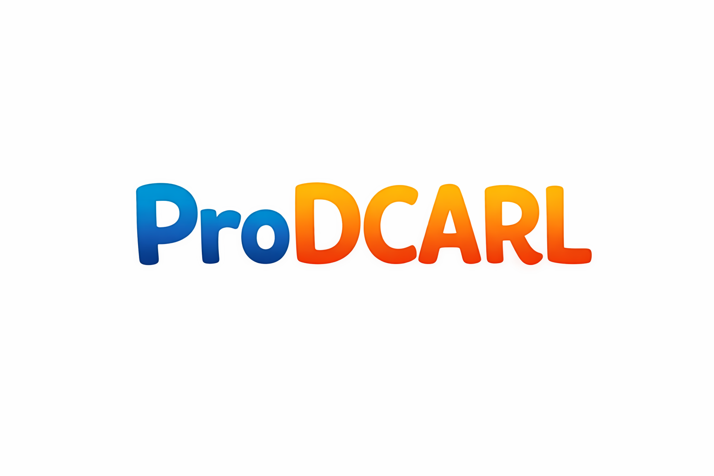

# ProDCARL: Reinforcement Learning-Aligned Diffusion Models for De Novo Antimicrobial Peptide Design

Fang Sheng, Mohammad Noaeen, Zahra Shakeri  
arXiv:2602.00157 [q-bio.QM] (2026)  
https://arxiv.org/abs/2602.00157

## Overview

This repository contains the core implementation of **ProDCARL**, a method that combines discrete diffusion models with reinforcement learning (RL) to generate short antimicrobial peptides (AMPs) optimized for high predicted antimicrobial activity (pAMP) and low predicted toxicity (pTox).

The pipeline consists of three main stages:

1. **Supervised fine-tuning** of the EvoDiff OA-DM 38M model on known AMP sequences (domain adaptation)
2. **Policy-gradient RL alignment** using a composite reward = (pAMP + (1 − pTox))^2, implemented via top-k REINFORCE with entropy regularization
3. **Large-scale generation** and scoring of candidate 30-residue sequences

The reward signal is provided by two lightweight classification heads (Multi-Scale CNNs and Self-Attention) that operate on ProtT5-XL embeddings.

In silico evaluation shows significant improvement in mean pAMP while preserving sequence diversity.


## Main Features
- Fine-tuning and RL alignment of EvoDiff OA-DM 38M
- Reward model: ProtT5-XL + CNN-Transformer classification heads for AMP probability and toxicity probability
- Top-k policy gradient optimization (top 30% sequences used for policy update)
- Entropy bonus to discourage mode collapse
- Batch generation with OA-AR-DM sampling
- Final output: `results/prodcal.csv` containing sequences with pAMP and pTox scores

## Required Files (place in working directory)

- best_toxic_model.pt            — pre-trained toxicity classifier checkpoint
- head_only.pt                   — pre-trained AMP classifier checkpoint
- positive_samples.fasta         — FASTA file of known positive AMP sequences (used for supervised fine-tuning)
- ProtT5-XL weights (Rostlab/prot_t5_xl_half_uniref50-enc) are automatically downloaded from Hugging Face.

## Usage
All steps are currently executed by running the main script:
run.py

## Typical hyperparameters

- Sequence length during RL and generation: 30 residues
- RL steps: 40
- Batch size during sampling: 200
- Top-k fraction: 30%
- Entropy coefficient: 3.0
- Reward: pAMP + (1 - pTox)
- Reward shaping: reward ** 2

## Output file format (results/prodcal.csv)
```
sequence,pAMP,pTox
xxxxxxxxxxxxxxxxxxxxxxxxxx,0.812345,0.112233
```

## Main Functions in the Code

| Function                  | Purpose                                                                 |
|---------------------------|-------------------------------------------------------------------------|
| `fine_tune_oadm()`        | Supervised fine-tuning on positive AMP sequences                        |
| `warmup_supervised()`     | (Optional) simpler next-token prediction warmup                         |
| `train_rl()`              | Top-k REINFORCE-style policy gradient optimization                      |
| `generate_and_save()`     | Generate 1,000 sequences + batch scoring with ProtT5 + classifier heads |
| `compute_reward()`        | Calculate composite reward from classifier outputs                      |
| `ProteinHead`             | CNN + Transformer classification head (used for both AMP and toxicity)  |


## Acknowledgments

- Built on EvoDiff (OA-DM architecture and sampling routines) (https://github.com/microsoft/evodiff)
- Protein embeddings from ProtT5-XL (Rostlab)
- Classifier heads trained separately, see notebook

## Citation
```
@article{sheng2026prodcarl,
  title={ProDCARL: Reinforcement Learning-Aligned Diffusion Models for De Novo Antimicrobial Peptide Design},
  author={Sheng, Fang and Noaeen, Mohammad and Shakeri, Zahra},
  journal={arXiv preprint arXiv:2602.00157},
  year={2026}
}
```
